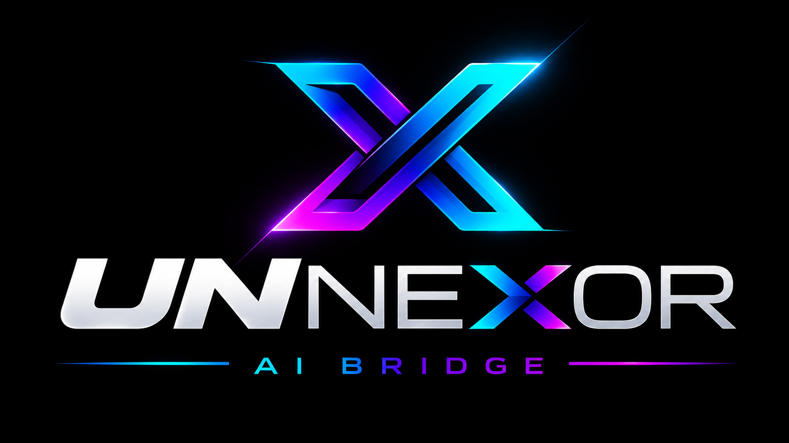

<p align="center">
  
</p>

<p align="center">
  <b>Tu IA local, conectada a tu navegador y a tu escritorio.</b><br>
  Selecciona, pregunta, escucha y traduce con modelos que corren en tu propio equipo.<br>
  <sub>UNnexor AI Bridge · desarrollado por UnlessDev</sub>
</p>

<p align="center">
  <a href="docs/UNNEXOR_OVERVIEW.md"><b>¿Qué es UNnexor? →</b></a> ·
  <a href="docs/INSTALLATION.md">Instalación</a> ·
  <a href="docs/COPILOT.md">Copiloto</a> ·
  <a href="ARCHITECTURE.md">Arquitectura</a> ·
  <a href="CHANGELOG.md">Novedades</a>
</p>

---

**UNnexor** (*UN* de UnlessDev, *nexor* de indexación) une una extensión de
navegador, una aplicación de escritorio y modelos de IA locales (Ollama):

- ✦ **Texto del navegador**: selecciona texto y pulsa la X → *Enviar
  directamente* o *Consultar…* con tu propia pregunta.
- 🧭 **Copiloto en tiempo real**: asistencia en conversaciones (escucha
  continua, temporizada o con tecla), traducción en vivo y desafíos en
  pantalla (visión u OCR).
- 📄 **Perfil con tus documentos** (.md / .txt) como contexto local.
- ✨ **Recomendar configuración**: evalúa tu CPU, RAM, GPU y disco y propone
  modelos y parámetros por función, en tres perfiles de consumo.
- 🔒 **Local por defecto**: los proveedores remotos son opcionales y
  requieren tu consentimiento.

> Presentación completa del proyecto: **[docs/UNNEXOR_OVERVIEW.md](docs/UNNEXOR_OVERVIEW.md)**.
> Identidad gráfica y nombres técnicos conservados: [docs/BRANDING.md](docs/BRANDING.md).

### Requisitos principales

- Windows 10/11 de 64 bits.
- [Ollama](https://ollama.com/download) instalado (UNnexor lo inicia si no
  está abierto y lo detiene al salir solo si lo inició él).
- Chrome, Brave o Edge para la extensión.
- Desde el código fuente: Python 3.12.

### Descargar para Windows

<p>
  <a href="https://github.com/unlessDev/UNnexor/releases/latest/download/UNnexor-Setup-Windows-x64.exe"><b>⬇ Descargar UNnexor para Windows (instalador .exe)</b></a>
  · <a href="https://github.com/unlessDev/UNnexor/releases/latest">todas las descargas</a>
</p>

Ejecuta el instalador (no requiere administrador; Windows SmartScreen puede
avisar porque aún no está firmado: «Más información» → «Ejecutar de todas
formas») y abre **UNnexor** desde el menú Inicio. Al abrirse inicia el puente local, comprueba Ollama y
muestra el panel; al cerrarlo detiene todo lo que inició. Ver
[docs/INSTALLATION.md](docs/INSTALLATION.md).

## Estado del proyecto

| Área | Estado |
|---|---|
| Extensión MV3 | Funcional; paquete de tienda generado y validado localmente |
| Puente local + panel | Funcional; ejecutable one-folder generado y validado |
| Copiloto en tiempo real | Funcional (conversación con escucha continua/temporizada/manual, traducción, desafíos); incluido en el ejecutable |
| Pruebas | `527 passed, 1 skipped` (2026-11-28, versión 2.1.0 en la rama `feature/ux-overhaul`) |
| Instalador Windows | v2.0.0 publicado en [Releases](https://github.com/unlessDev/UNnexor/releases/latest); 2.1.0 generado y probado localmente, **sin publicar** (Inno Setup, por usuario, sin firma Authenticode) |
| Publicación en tiendas | No iniciada; requiere cuentas de desarrollador y URL pública de privacidad |
| Licencia | **Apache-2.0** ([LICENSE](LICENSE)) |
| macOS / Linux | Previstos; por ahora solo Windows 10/11 x64 |

```
Selección en el navegador → Botón X (Enviar / Consultar) → Puente local (FastAPI)
                              → Ollama local (streaming HTTP)
                              → Panel flotante PySide6 (siempre visible por ventana + hover scroll)
```

## Módulos

| Carpeta | Qué es |
|---|---|
| `browser-extension/` | Extensión Manifest V3 (Chrome/Brave/Edge): botón contextual sobre la selección + envío al puente. |
| `local-bridge/` | Servidor local Python (FastAPI) + panel flotante PySide6 + cliente Ollama con streaming real + copiloto en tiempo real (`app/audio`, `app/stt`, `app/copilot`, `app/knowledge`, `app/routing`, `app/desktop/copilot`). |
| `deployment/` | Empaquetado reproducible de la extensión, ejecutable one-folder e instalador Windows, con pruebas de humo e integridad. |
| `scripts/` | PowerShell: `install.ps1`, `start.ps1`, `stop.ps1`, `check_environment.ps1` (+ helper opcional AHK v2). |
| `docs/` | Instalación, configuración, proveedores, OCR, guías de tienda, ADR y auditoría. |

## Inicio rápido

```powershell
cd G:\Proyectos\UNnexor

# 1) Instalar (venv + dependencias + .env con token + chequeo de Ollama)
powershell -ExecutionPolicy Bypass -File scripts\install.ps1

# 2) Arrancar (servidor + panel flotante)
powershell -ExecutionPolicy Bypass -File scripts\start.ps1

# 3) Cargar la extensión
#    chrome://extensions → Modo desarrollador → Cargar descomprimida
#    → carpeta browser-extension → abre "Opciones" y sigue el asistente:
#    panel ☰ → Emparejar extensión → código de 6 dígitos → Conectar.
#    (Alternativa manual: pegar el token de local-bridge\.env.)
```

Detalles completos: [`docs/INSTALLATION.md`](docs/INSTALLATION.md).

### Empaquetar la extensión

```powershell
python deployment\extension\build.py --check   # validación de manifest y recursos
python deployment\extension\build.py           # ZIPs + SHA-256 + informe
```

Genera `release/browser-extension/chrome.zip` y `edge.zip` (ignorados por
Git) con `SHA256SUMS.txt` y `build-report.json`. Los paquetes solo incluyen
archivos de producción. Estado de tiendas:
[Chrome Web Store](docs/stores/CHROME_WEB_STORE.md),
[Edge Add-ons](docs/stores/EDGE_ADDONS.md),
[permisos](docs/stores/PERMISSIONS.md) y
[matriz de cumplimiento](docs/stores/COMPLIANCE_MATRIX.md).

### Empaquetar la aplicación de escritorio

```powershell
cd local-bridge
.venv\Scripts\python.exe -m pip install -r requirements-build.txt
.venv\Scripts\python.exe ..\deployment\windows\build.py
```

Genera `release/windows/UNnexor/UNnexor.exe` (one-folder, sin consola),
un ZIP `UNnexor-<versión>-win64-unsigned.zip`, `SHA256SUMS.txt` y un
informe con pruebas de humo headless y GUI offscreen. El build no está
firmado con Authenticode y no incluye modelos, claves ni OCR pesado.

### Generar el instalador de Windows

```powershell
cd local-bridge
.venv\Scripts\python.exe ..\deployment\installer\build.py
```

Requiere Inno Setup 6. Compila y prueba el ciclo completo en directorios
temporales: instalación silenciosa por usuario, `UNnexor.exe --check`,
desinstalación con datos preservados, `--purge-secrets` y limpieza
completa. Genera `release/installer/UNnexor-<versión>-win64-setup.exe`,
`SHA256SUMS.txt` y un informe. El instalador se instala por usuario en
`%LOCALAPPDATA%\Programs\UNnexor` y guarda los datos en
`%LOCALAPPDATA%\UNnexor` (los datos de versiones anteriores, en
`%LOCALAPPDATA%\Extdator`, se copian automáticamente en el primer arranque
sin borrar la carpeta antigua).

No hay release pública todavía. Para borrar solo credenciales y el token
sin desinstalar:

```powershell
& "$env:LOCALAPPDATA\Programs\UNnexor\UNnexor.exe" --purge-secrets
```

El token se regenera en el siguiente arranque y la extensión deberá
volver a emparejarse.

### CI, SBOM y verificación de artefactos

GitHub Actions ejecuta en Windows la suite de pruebas y el empaquetado
completo (extensión, escritorio, instalador y SBOM) en cada push o pull
request a `main` y `develop`. El flujo está en `.github/workflows/ci.yml`.
No publica releases ni firma artefactos: solo construye, prueba y sube
artefactos temporales de CI.

Para reproducirlo en local, después de compilar los tres paquetes:

```powershell
cd local-bridge
.venv\Scripts\python.exe ..\deployment\sbom\build.py
.venv\Scripts\python.exe ..\deployment\verify_artifacts.py
```

El SBOM es CycloneDX 1.5 e inventaría el entorno Python de build/runtime,
la extensión y el puente. La verificación comprueba los SHA-256, los
informes de build y el propio SBOM, y escribe
`release/verification-report.json`. Detalles y límites:
[`docs/CI.md`](docs/CI.md).

## Características

### 🌐 Extensión del navegador (Chrome, Brave, Edge)
* Botón con la **X de UNnexor** junto al texto seleccionado (Shadow DOM: no
  altera la página). Al pulsarlo:
  * **Enviar directamente**: el texto seleccionado llega tal cual al modelo.
  * **Consultar…**: un panel pequeño para escribir una pregunta u orden
    sobre la selección (Ctrl+Enter / Esc). La consulta es la tarea y la
    selección su contexto; las consultas siguientes conservan el contexto.
    (En 2.0.0 la pregunta no llegaba al puente; corregido en 2.1.0.)
* Página de opciones con asistente de conexión en 4 pasos y cabecera
  animada; emparejamiento con código de 6 dígitos.
* Permisos mínimos: `storage` + acceso solo a `127.0.0.1`/`localhost`.

### 🪟 Aplicación de escritorio
* Panel flotante que **no roba el foco**, con Hover Scroll, historial y
  streaming; redimensionable y minimizable.
* **Respuestas formateadas**: fórmulas compuestas de verdad (fracciones,
  raíces, sumatorias, integrales, límites, matrices, sistemas, letras
  griegas) con ziamath, y bloques de código con **resaltado de sintaxis**
  (Python, JavaScript, TypeScript, HTML, CSS, SQL, JSON, Bash, C, C++,
  Java, C#, PHP, YAML…), etiqueta de lenguaje y botón «Copiar código». Sin
  motor web ni JavaScript: el HTML del modelo nunca se interpreta.
* **Centro de control** (menú ☰ o icono de la bandeja): estado de Ollama,
  modelo activo y descargas, guía de uso en tres pasos, acciones
  frecuentes y el catálogo de modelos integrado.
* Ventanas que se abren a un tamaño adaptado a tu pantalla, con scroll
  cuando hace falta (nada de textos cortados ni botones fuera de la vista).
* Iconos vectoriales propios y menú ☰ por secciones (Conversación,
  Herramientas, Modelos y configuración, Ventana).
* **Icono en el área de notificación**: abre el panel, el centro de
  control, el copiloto, los ajustes o la consola desde un único lugar.
* **«Siempre visible» real por ventana** (panel, copiloto y panel flotante).
* **Consola del puente opcional** con los registros en vivo (oculta por
  defecto).
* **Captura de región** → modelo con visión u OCR local.

### 🧭 Copiloto en tiempo real ([guía](docs/COPILOT.md))
* **Conversaciones**: audio del sistema (WASAPI loopback) y/o micrófono,
  Whisper local o remoto y respuestas **en primera persona, listas para
  decirlas en voz alta** (sin «Podrías responder…»), con tu perfil y
  documentos y sin inventar datos. Escucha **continua**, **temporizada**
  (10 s – 10 min) o **manual con tecla**.
* Panel flotante legible: lo que dice el interlocutor (texto provisional en
  cursiva) separado de **tu respuesta** destacada; se **cierra** con ✕ (la
  escucha se detiene y libera el audio; UNnexor sigue abierto).
* **Traducción en vivo** con texto provisional/confirmado, resumen y
  exportación TXT/Markdown/PDF.
* **Desafíos en pantalla**: región, pantalla completa, varias regiones o
  análisis periódico.
* **Perfiles** con documentos `.md`/`.txt` como contexto local (BM25 +
  embeddings opcionales).

### 🤖 Modelos y rendimiento
* **Recomendar configuración**: detecta CPU, RAM, GPU (NVIDIA/AMD/Intel,
  VRAM, aceleración real), disco y sistema; tres niveles de consumo en
  tarjetas con la misma clasificación del catálogo, y una propuesta por
  función. **Aplicar** pide tu autorización (con tamaño y recursos),
  descarga e instala lo que falte con progreso real, verifica cada modelo y
  solo entonces lo activa; si algo falla, «Reintentar» pide solo lo que
  falló. Copia de seguridad y restauración incluidas.
* **Descargas con progreso real**: porcentaje sobre el total de todas las
  capas, MB descargados, velocidad y fases (preparando, descargando,
  verificando, finalizando); nunca 100 % antes de terminar y verificar.
  Continúan aunque cierres la ventana; una sola a la vez, sin duplicados.
* **Catálogo de Ollama en línea** (modelos nuevos, capacidades, tamaños
  estimados) y aviso de versiones nuevas de Ollama; nunca descarga nada solo.
* Clasificación de cada modelo para tu equipo: ÓPTIMO, COMPATIBLE, EXIGENTE,
  NO COMPATIBLE o NO EVALUADO; mediciones reales de velocidad.
* **Ollama gestionado**: UNnexor lo inicia si está cerrado y al salir
  detiene solo lo que inició.

### 🔌 Proveedores remotos (opcional)
* Catálogo con nivel de acceso y costes (gratuito, limitado, créditos,
  pago por uso, local) y consentimientos explícitos por servicio.
* OpenAI-compatible (OpenAI, Groq, OpenRouter, Mistral, Gemini, xAI…),
  Anthropic nativo y Deepgram para voz. Claves en el Administrador de
  credenciales de Windows.

### 🧱 Puente local y seguridad
* FastAPI solo en `127.0.0.1`, token/emparejamiento, CORS por origen,
  límites de tamaño y de tasa, cola sin bloqueos y registros sin contenido
  privado por defecto.
* Diagnóstico exportable sin secretos; desinstalación con purga opcional.

## Privacidad

El texto seleccionado va **solo** a tu Ollama local (`127.0.0.1`),
salvo que conectes expresamente un proveedor remoto (entonces va a ese
proveedor y únicamente a él). Las claves API conectadas desde el panel
viven en el keyring del sistema; las que pongas manualmente en `.env`
pueden retirarse con `--purge-secrets`. Las capturas de pantalla se borran
de `%TEMP%` tras procesarlas. Ninguna petición sale de tu máquina sin que tú lo configures.
El copiloto procesa el audio en memoria (nunca lo guarda) y solo envía contenido a un servicio externo si le diste permiso expreso en 'Motores y modelos'.
Los logs no registran el contenido de las selecciones por defecto. No hay
analítica ni publicidad. El diagnóstico exportable desde el menú ☰ se redacta antes
de guardarse y no incluye token, claves API, `.env`, historial ni capturas;
aun así, conviene revisar el ZIP antes de compartirlo. Política completa:
[`browser-extension/privacy.html`](browser-extension/privacy.html) (su
publicación en una URL pública para las tiendas está pendiente).

## Documentación

* [Arquitectura y decisiones técnicas](ARCHITECTURE.md)
* [Instalación paso a paso](docs/INSTALLATION.md)
* [Configuración completa](docs/CONFIGURATION.md)
* [Proveedores de IA remotos](docs/PROVIDERS.md)
* [Guía del copiloto en tiempo real](docs/COPILOT.md)
* [Reconocimiento de voz: motores, costes y mediciones](docs/SPEECH.md)
* [Estado del copiloto por etapas](docs/COPILOT_STATUS.md)
* [OCR local para capturas](docs/OCR.md)
* [Catálogo de modelos y evaluador](docs/MODELS_CATALOG.md)
* [Solución de problemas](docs/TROUBLESHOOTING.md)
* [Mapa de dependencias](docs/DEPENDENCY_MAP.md)
* [CI, SBOM y verificación](docs/CI.md)
* [Preparación para Chrome Web Store](docs/stores/CHROME_WEB_STORE.md)
* [Preparación para Edge Add-ons](docs/stores/EDGE_ADDONS.md)
* [Permisos de la extensión](docs/stores/PERMISSIONS.md)
* [Matriz de cumplimiento](docs/stores/COMPLIANCE_MATRIX.md)
* [Auditoría inicial](docs/AUDIT_2026-11-19.md)
* [Registro de cambios](CHANGELOG.md)

## Pruebas

```powershell
.\local-bridge\.venv\Scripts\python.exe -m pytest local-bridge\tests -v
```

Cubre: validación/seguridad del servidor, CORS, streaming de Ollama
(simulado), historial, configuración, ajustes persistentes, hardware y
evaluador de modelos, emparejamiento, proveedores (transporte simulado),
OCR (motores opcionales con mocks), límites de arquitectura, rutas de
runtime, validación/empaquetado de la extensión, diagnóstico saneado, purga
de secretos y una prueba de integración real de Hover Scroll/no-activación
sobre Windows.
El instalador añade su propia prueba de ciclo completo (instalar,
auto-chequeo, preservar datos, purgar y desinstalar). Complemento GUI
offscreen: `local-bridge\scripts\gui_smoke.py` (abre los cinco diálogos sin
pantalla).

## Licencia

UNnexor se distribuye bajo la **[Apache License 2.0](LICENSE)** · Copyright
2026 UnlessDev (ver [NOTICE](NOTICE) y
[ADR-0004](docs/adr/0004-project-license-pending.md)).

Las dependencias de terceros conservan sus licencias; el inventario y los
avisos se mantienen en [THIRD_PARTY_NOTICES.md](THIRD_PARTY_NOTICES.md).
